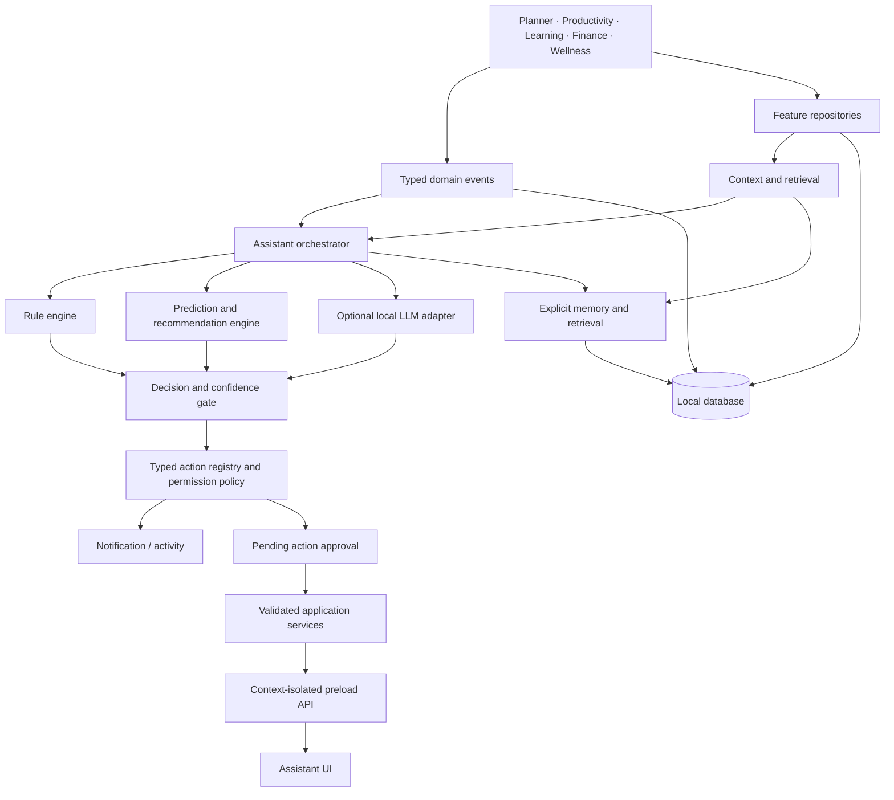

# Sidekick P.A. AI System Architecture

## Purpose and verified baseline

Sidekick is an Electron application with a React renderer, a TypeScript/Node.js main process, a preload bridge, feature repositories, and a shared main-process scheduler. The active database implementation is MySQL/MariaDB via `mysql2`, configured for local XAMPP development in `src/main/database/connection.ts`; SQLite is a stated future target, not the current runtime. Migrations 001–019 are registered. The renderer uses `contextIsolation: true` and `nodeIntegration: false` in `src/main/main.ts`.

The assistant already has deterministic monitoring (`assistant-engine.ts`, `rule-engine.ts`), a typed in-process event bus, context snapshots across Planner, Productivity, Wellness, Finance, and Learning, persistent findings, native notifications, persisted conversations, and user-managed memories. The optional loopback-only Ollama-compatible adapter uses bounded structured responses. It can draft a Planner task only after an explicit request, and task creation requires approval in the UI. Opt-in background reasoning is rate-limited and read-only. A personal task-delay logistic model is implemented with strict data and chronological evaluation gates, versioned artifacts, and SHA-256 integrity checks. The model runtime is not installed and no trained model or real inference is available in the development environment.

## Architecture decision

Use a **hybrid, main-process-owned intelligence service**. Deterministic rules remain the reliable baseline. Conversational inference is optional and local. Statistical models are introduced only for narrow predictions after the data pipeline and minimum-data gates exist. The renderer requests explanations, recommendations, and actions through typed IPC; it never accesses model files, credentials, SQL, or unrestricted Node APIs.

## Subsystems and contracts

| Subsystem | Responsibility and contract | Failure behavior |
|---|---|---|
| Context Engine | Build a timestamped, bounded snapshot from feature services. Each domain is either a typed value or explicitly unavailable; never synthesize zero for a failed source. | Partial results carry `degradedModules`; a failed domain does not block other domains. |
| Learning Engine | Convert validated, explicit feedback and eligible historical records into versioned feature sets and model candidates. It does not mutate user records. | If minimum data or quality checks fail, report `insufficient_data` and keep rules active. |
| Prediction Engine | Return `{kind, value, confidence, horizon, modelVersion, evidenceWindow}`. Predictions are estimates, not facts. | Reject stale, invalid, or low-confidence outputs; fall back to rules. |
| Decision Engine | Rank observations and suggestions using severity, relevance, confidence, quiet hours, notification preferences, and recent outcomes. | Suppress low-value/duplicate suggestions; retain explanation and suppression reason. |
| Recommendation Engine | Produce a typed proposal with rationale, evidence references, expiry, and category. | Never auto-execute a recommendation as a side effect. |
| Memory and retrieval | Retrieve only relevant, user-approved memories and bounded domain records. Separate short-term conversation from long-term explicit memory. | Memory disabled, unavailable, or empty means no memory context; chat continues. |
| AI Orchestrator | Coordinate bounded context, rules, model adapter, prediction/recommendation outputs, and decision policy. Own cancellation, timeout, correlation IDs, and idempotency. | Every stage has a timeout/fallback; no unhandled model output reaches a service. |
| Model Management | Track local provider/model availability, resource policy, versions, and health. Distinguish configured, available, and inference-tested states. | Optional model failure cannot disable planner, reminders, or rules. |
| Feedback Processing | Record explicit user acceptance, dismissal reason, correction, or rating separately from passive outcomes. | Ignored notifications are not inferred as dislike; duplicate feedback is idempotent. |
| Safety and Permission | Validate action schemas, classify risk, enforce approval and freshness checks, and call existing feature services. | Deny unknown actions by default and log a safe audit record. |

## Information lifecycle

Feature services emit domain events after successful mutations. The orchestrator coalesces bursts, requests a fresh context snapshot, and runs deterministic checks. Eligible prediction jobs run separately and infrequently. Optional LLM calls receive only a bounded, purpose-specific context when configured. The decision engine creates observations or recommendations; only the action registry can create an activity/notification or submit a user-approved action to a feature service. The UI identifies whether content is an observation, prediction, recommendation, pending action, or completed action.

## Autonomy boundary

The current assistant may create local activity and show notifications from registered actions. It may also execute one narrowly typed Planner task proposal after explicit user approval. Live model behavior and unattended outcome reporting remain unverified. The next autonomy milestone requires (1) verified local model reasoning while the app is backgrounded, (2) safe typed action proposals, (3) user approval and execution through existing services, and (4) a verified outcome report. Do not describe the product as autonomous AI until that end-to-end path passes acceptance tests.

## Design constraints and unresolved decisions

- Keep the existing shared scheduler; do not add one timer per intelligence subsystem.
- Keep model inference optional and local by default. Never silently fall back to cloud.
- The existing application is MySQL/MariaDB-backed; production SQLite migration must precede a claim that the shipped intelligence store is SQLite-native.
- No passive application/window monitoring is currently part of the assistant context contract. Productivity intelligence must use explicitly tracked sessions until a separate, transparent opt-in design is reviewed.
- The local model call is loopback-only and timeout-bounded, but model availability and inference quality have not been live-tested because Ollama is not installed in the development environment.
- Voice, cloud connectors, desktop orb, and arbitrary computer control are outside the first intelligence release.

## Recommended first release

The first personalized prediction is the **Personal Task Delay Risk** estimate specified in `AI_MODEL_SPECIFICATIONS.md`, trained only from the user's own completed due-dated tasks if strict sample and chronological evaluation gates pass. It must not be trained by default or treated as a fact. If the user's history is too small (a likely outcome for a single-user desktop app), Sidekick remains rules-first and may show a transparent overall baseline only when its denominator is sufficient.

Before that model, complete a typed read-only tool catalog and approval queue for reversible Planner/Study actions; add explicit feedback and preference capture; add background local-model reasoning only as an opt-in, low-frequency stage after deterministic deduplication; and instrument end-to-end outcomes. Defer Python ML until a local SQLite-compatible feature store, privacy/export controls, and minimum-data evaluation are established.
